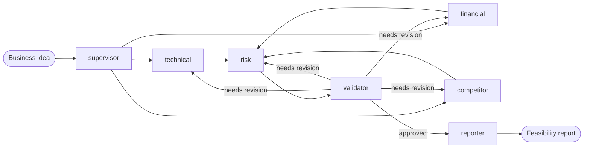

# Business Feasibility & Impact Analysis — Multi-Agent System

A team of AI agents that checks whether a new **e-commerce business idea** is
worth doing, before the company spends time and money on it.

You give it an idea, for example:

> "Add an AI chat assistant that answers *Where is my order?* questions in Egyptian Arabic."

The agents split the work. One looks at the technology, one at the money,
one at the competitors, one at the risks. A critic checks their work, and a
writer turns it into a report with a clear recommendation.

**The system supports human decisions. It does not replace them.** Every
conclusion must show its evidence and its assumptions, so people can check it.

This is a training project. The full proposal is in
`Business_Feasibility_Impact_Analysis_Proposal_v2.pdf`.

---

## Project status

**The shared base is ready. The four analysts run; the validator and reporter are stubs.**

| Part | Status |
|---|---|
| Configuration, shared state, blackboard | ✅ Ready |
| Supervisor agent (writes a brief for each agent) | ✅ Ready |
| Workflow graph with a revision loop | ✅ Ready |
| RAG layer: company knowledge base in Qdrant + search tool | ✅ Ready |
| HTTP API | ✅ Ready |
| Live dashboard (`frontend/`) | ✅ Ready: start runs, watch every agent live, reopen past runs |
| Technical, Financial, Competitor, Risk agents | ✅ Run the shared analyst loop (tools + finding). Owners tune prompts and output fields. |
| Validator, Reporter agents | 🚧 Stubs: one per team member |
| Web search tool (Exa) | ✅ Ready |

The four analysts share one work loop (`src/agents/analyst.py`): read the
idea, the supervisor's brief, the other agents' findings and the reviewer's
feedback, call tools up to 5 times, then return a finding with evidence.
Until the validator and reporter are built, the validator approves
everything and the reporter lists the findings. So the whole workflow
already runs from start to end.

---

## How it works



1. **Supervisor** reads the idea and writes a short brief for each agent.
2. **Technical**, **Financial**, and **Competitor** agents work at the same time.
3. **Risk** agent uses their findings to build a risk register.
4. **Validator** checks the evidence, numbers, and assumptions. It can send
   work back to specific agents (at most `max_revisions` times).
5. **Reporter** writes the final report.

### The agents

| Agent | Job | File |
|---|---|---|
| Supervisor | Understands the idea and briefs every agent | `src/agents/supervisor.py` |
| Technical | Can we build it with our systems, data, and APIs? | `src/agents/technical.py` |
| Financial | Cost, savings, ROI, payback period | `src/agents/financial.py` |
| Competitor | Who already offers this, at what price, how we can stand out | `src/agents/competitor.py` |
| Risk | Risks scored by probability × impact, with mitigations | `src/agents/risk.py` |
| Validator | Checks evidence, contradictions, calculations, assumptions | `src/agents/validator.py` |
| Reporter | Final report with a transparent recommendation | `src/agents/reporter.py` |

Each agent's full list of responsibilities is in the docstring at the top of
its file.

### Four ideas that shape the code

1. **Agents decide, tools act.** A tool does one action (for example, search
   company documents). An agent decides when to use which tool.
2. **RAG is a tool, not an agent.** Company knowledge is reached through the
   `search_company_docs` tool. Any agent can use it. Public web facts come
   from the `web_search` tool. Why it uses Exa is explained in
   [docs/research/web_search_selection.md](docs/research/web_search_selection.md).
3. **The blackboard.** Think of a whiteboard in a meeting room. Each agent
   pins its result on it, and the others can read it. Agents never write
   the shared state directly. They return a result, and
   `src/memory/blackboard.py` pins it in the right place.
4. **Configuration is data.** Agents are declared in `config/agents.yaml`. The
   order of the work is declared in `config/tasks.yaml`. The graph is built
   from these files, so changing the flow does not mean changing code.

---

## Tech stack

| Layer | Choice |
|---|---|
| Language | Python 3.11+ |
| Agents and workflow | LangChain + LangGraph |
| LLM | Groq (default model `openai/gpt-oss-120b`). You can switch it in `.env`. |
| Vector store | Qdrant in local mode: a folder on disk, no Docker needed |
| Embeddings | Sentence Transformers `all-MiniLM-L6-v2`, runs locally |
| Document parsing | Markdown/text, PDF (PyMuPDF), Word (python-docx) |
| API | FastAPI + Uvicorn; live events as Server-Sent Events |
| Run history | SQLite file (`.runs/runs.sqlite`), no server needed |
| Dashboard | React + TypeScript + Vite, React Flow for the graph, Tailwind |
| Tests | pytest |

---

## Project structure

```
.
├── .env.example              # Template for your local settings and API keys
├── pyproject.toml            # Dependencies and tool settings
├── config/
│   ├── agents.yaml           # Every agent: role, goal, prompt, tools, LLM settings
│   ├── tasks.yaml            # Workflow stages, revision limit, task for each agent
│   ├── models.py             # Typed shape of the two YAML files, checked at load
│   └── settings.py           # Reads .env and the YAML files
├── data/
│   └── knowledge_base/       # Synthetic company documents used by RAG
├── src/
│   ├── agents/
│   │   ├── base.py           # BaseAgent contract + build_agent factory
│   │   ├── analyst.py        # Shared work loop of the four analysts
│   │   ├── request.py        # How agents write their request to the LLM
│   │   ├── supervisor.py     # Orchestrator: briefs the other agents
│   │   └── technical.py, financial.py, competitor.py,
│   │       risk.py, validator.py, reporter.py
│   ├── tools/
│   │   ├── base.py           # Tool registry and @register_tool
│   │   ├── db_tool.py        # search_company_docs (RAG search)
│   │   ├── web_search.py     # web_search (Exa web search)
│   │   └── code_runner.py    # Placeholder: not decided yet
│   ├── orchestrator/
│   │   ├── state.py          # Shared state and data models
│   │   ├── graph.py          # Builds the LangGraph workflow from tasks.yaml
│   │   ├── router.py         # Revise or move on after the validator
│   │   └── events.py         # Live events agents emit for the dashboard
│   ├── runs/
│   │   ├── service.py        # The one place that runs the graph
│   │   └── store.py          # Saves runs and their events in SQLite
│   ├── memory/
│   │   ├── blackboard.py     # The only writer of agent results into the state
│   │   ├── long_term.py      # Qdrant vector store
│   │   ├── ingest.py         # Load, chunk, and store company documents
│   │   └── short_term.py     # Saves run state while the app runs
│   ├── prompts/
│   │   ├── supervisor.md
│   │   └── system_messages/  # One system prompt per agent
│   └── utils/
│       ├── logger.py         # Logs and per-agent timing
│       ├── guardrails.py     # Checks what agents return
│       └── llm.py            # Creates chat models; structured output
├── api/
│   ├── app.py                # Puts the routers together; serves the dashboard
│   ├── routes/               # analyses.py, runs.py (incl. live SSE), workflow.py
│   ├── schemas.py            # Response models (the dashboard's types come from them)
│   ├── static.py             # Serves frontend/dist as a single-page app
│   └── dependencies.py       # Graph, run store, and run service for the endpoints
├── frontend/                 # The live dashboard (see "6. Open the dashboard")
│   └── src/
│       ├── api/              # client.ts + schema.d.ts (generated from the API)
│       ├── run/              # deriveRunView.ts: events -> what each view shows
│       ├── components/       # Graph, timeline, agent panel, live log, report
│       └── pages/            # Home (new run + history) and the run view
└── tests/
    ├── conftest.py           # Fake LLM and in-memory Qdrant
    ├── test_agents/
    ├── test_tools/
    └── test_workflow.py      # Full workflow and API tests
```

---

## Getting started

### 1. Install

```bash
python -m venv .venv
# Windows
.venv\Scripts\activate
# macOS / Linux
source .venv/bin/activate

pip install -e ".[dev]"
```

### 2. Configure

```bash
cp .env.example .env
```

Open `.env` and set `GROQ_API_KEY`. You can create a free key at
<https://console.groq.com/keys>.

Then set `EXA_API_KEY` for the `web_search` tool. You can create a free key
at <https://dashboard.exa.ai>. Without it, everything else works, but a web
search fails with a message that asks for the key.

### 3. Load the company knowledge base

```bash
python -m src.memory.ingest --rebuild
```

The first run downloads the embedding model (about 90 MB). The documents
are saved in the `.qdrant/` folder.

> **Local mode allows only one program at a time to open `.qdrant/`.**
> Stop the API before you run the ingest command again.

### 4. Run the API

```bash
uvicorn api.app:app --reload
```

Open <http://127.0.0.1:8000/docs> to try it in the browser, or:

```bash
curl -X POST http://127.0.0.1:8000/analyses \
  -H "Content-Type: application/json" \
  -d '{"idea": "Add an AI chat assistant that answers Where is my order questions.", "context": "Pilot budget around EGP 1.5 million."}'
```

The answer contains the supervisor's `plan`, every agent's `findings`, the
`validation` result, and the `report`.

Every analysis, from here or from the dashboard, is saved in
`.runs/runs.sqlite` with all its live events, so you can reopen it later.

### 5. Run the tests

```bash
pytest
cd frontend && npm test
```

The Python tests use a fake LLM, an in-memory Qdrant, and a temporary run
history, so they need no API key and no internet.

### 6. Open the dashboard

The dashboard starts analyses and shows them live: which agent is working,
what it is searching for, who is waiting for whom, and the final report.

**Every day** (two terminals):

```bash
uvicorn api.app:app --reload          # terminal 1, port 8000
cd frontend && npm install && npm run dev   # terminal 2, opens on port 5173
```

Open <http://127.0.0.1:5173>. Vite sends `/api` calls to port 8000.

**One server only:** run `npm run build` in `frontend/` once. Then
`uvicorn api.app:app` also serves the dashboard at <http://127.0.0.1:8000/>.

**After changing an API response model**, keep the API running and run
`npm run gen:api` in `frontend/`. It regenerates `src/api/schema.d.ts`, so
the TypeScript types match the Python models.

| Screen | What you see |
|---|---|
| Home | New analysis form, and every past run with its status |
| Run → Graph | The workflow from `tasks.yaml`. Each card shows the status, what the agent is doing now, time, and tool calls. Amber edges point at who an agent waits for. |
| Run → Timeline | One row per agent. Solid bars are running, striped bars are waiting, dots are tool calls. |
| Run → Report | The final report |
| Agent panel | Click an agent: its live activity (each LLM call, search, and result), its brief, and its output with evidence links |
| Live log | Every event, filterable by agent |

> **Groq's free tier allows 8,000 tokens per minute.** Three analysts work
> in parallel, so runs often fail with "429 rate limit". The dashboard shows
> which agent hit it. A paid Groq tier or another provider in `.env` fixes it.

---

## Configuration

### `.env`

| Variable | What it does |
|---|---|
| `LLM_PROVIDER`, `LLM_MODEL` | Which chat model all agents use. Any provider supported by LangChain `init_chat_model` works; install its package too. |
| `GROQ_API_KEY` | Key for Groq. Other providers use their own key variable. |
| `EXA_API_KEY` | Key for Exa, used by the `web_search` tool. |
| `EMBEDDING_MODEL` | Sentence Transformers model for the knowledge base. |
| `QDRANT_URL` | Empty = local mode. Set it to use a Qdrant server. |
| `QDRANT_PATH` | Folder for local mode. |
| `QDRANT_COLLECTION` | Collection name for the company documents. |
| `KNOWLEDGE_BASE_DIR` | Folder that the ingest command reads. |
| `RUNS_DB_PATH` | SQLite file for the run history. A file, not a server. |
| `LOG_LEVEL` | `INFO` shows when each agent starts and how long it took. |

Both YAML files are loaded into typed models (`config/models.py`). A
misspelled key, an unknown agent name, or a broken workflow stops the app at
start-up with a clear message, not in the middle of a run.

### `config/agents.yaml`

One entry per agent: `class_path`, `role`, `goal`, `backstory`,
`prompt_file`, `tools`, and optional `llm` settings (`temperature`, or a
different `model` / `provider` for this agent only).

### `config/tasks.yaml`

- `workflow.stages`: the order of the work. Agents in the same stage run in
  parallel.
- `workflow.review`: which agent can send work back, and `max_revisions`.
- `tasks`: what each agent is asked to do and what it should return. The
  supervisor reads these when it writes the briefs.

---

## The company knowledge base

The agents analyse ideas for **NileCart**, a **fictional** Egyptian online
retailer. Its documents are in `data/knowledge_base/`:

| File | Content |
|---|---|
| `01_company_profile.md` | Size, business model, strategy |
| `02_products_and_services.md` | Categories, services, payment mix, support channels |
| `03_departments_and_processes.md` | Teams, order and support processes, project approval |
| `04_it_architecture.md` | Systems, data, capacity, technical debt |
| `05_api_and_integrations.md` | Internal APIs, partners, integration rules |
| `06_security_and_data_policy.md` | Data protection rules, AI usage policy, past incidents |
| `07_financial_assumptions.md` | Costs, hurdle rate, payback limit, business metrics |
| `08_past_projects_and_market_research.md` | Lessons from past projects, survey results |

To add documents, drop `.md`, `.txt`, `.pdf`, or `.docx` files in that folder
and run the ingest command again.

---

## How to build your agent

Each team member owns one agent file. **You should only need to change your
own agent file, your prompt file, and your tests.** If you need to change the
base (`base.py`, `graph.py`, `state.py`, `blackboard.py`), agree on it with
the team first, because every agent depends on it.

1. **Write the logic in `analyze()`** in your file in `src/agents/`. It gets
   the shared `state` and must return your output model.
   Analysts return an `AgentFinding`.

   ```python
   from src.agents.base import BaseAgent
   from src.memory import blackboard
   from src.orchestrator.state import AgentFinding, FeasibilityState, FindingStatus


   class TechnicalAgent(BaseAgent):
       def analyze(self, state: FeasibilityState) -> AgentFinding:
           idea = state["idea"]                           # the user's idea
           brief = blackboard.read_brief(state, self.name)  # the supervisor's brief
           # self.llm, self.tools, self.system_prompt, self.task are ready to use
           ...
           return AgentFinding(
               agent=self.name,
               status=FindingStatus.DONE,
               summary="...",
               score=7.0,
               assumptions=["..."],
               evidence=[...],
           )
   ```

2. **Read other agents' results** with `blackboard.read_findings(state)`.
   The risk agent needs this. The validator and reporter do too.
3. **Need more fields** (a cost table, a risk register)? Subclass
   `AgentFinding` in your file and add them. The API returns the extra fields.
4. **Improve your prompt** in `src/prompts/system_messages/<agent>.md`.
5. **Choose your tools** in your agent's `tools:` list in `config/agents.yaml`.
6. **Validator only:** put agent names in `revision_requests` to send their
   work back. The workflow re-runs them and checks again.
7. **Add tests** in `tests/test_agents/`. Use the `fake_llm` fixture, so tests
   need no API key.

### How to add a tool

```python
# src/tools/my_tool.py
from src.tools.base import register_tool

@register_tool
def my_tool(query: str) -> str:
    """Explain to the LLM what this tool does and when to use it."""
    ...
```

Then import the module in `src/tools/__init__.py`, and add `my_tool` to the
`tools:` list of the agents that need it.

---

## Open tasks

- **Specialist agents:** Technical, Financial, Competitor, Risk, Validator,
  and Reporter. One owner each. Start with
  [docs/building_an_agent.md](docs/building_an_agent.md).
